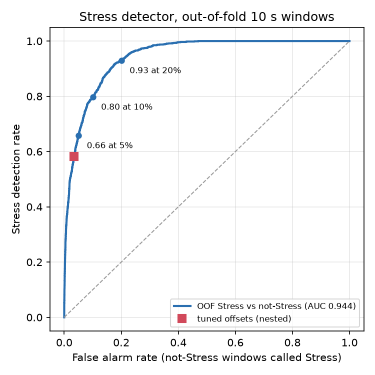

# Results

## Protocol

- Data: official kit only (85 recordings, 36 users).
- CV: `GroupKFold(n_splits=5, shuffle=True, random_state=0)` grouped by `user_id`. A person never appears in both the train and test parts of a fold.
- Metric (mirrors the competition): rows with unscored truth are ignored. For each 10 s window aligned to the epoch, take the majority true label and the majority predicted label over the scored rows. Macro-F1 is computed over Rest, Activity and Stress; each fold pools all its test windows. Tables show mean and std over folds.
- Per-class F1 is computed on all out-of-fold windows pooled.
- All tuning happens inside training folds: Kalman noise uses maximum likelihood on the training recordings of each fold. Decoder parameters (offsets, HMM) are tuned with nested evaluation: for each outer fold, only on the other folds' out-of-fold predictions.
- MET: mean of 50 `run()` calls on STRESS/f01 (201,305 rows, the longest file), one thread. Official speed score = (1 - MET / 0.3 s) x 20.
- Leaderboard: submission_B scored 83 / 100, which confirms that `run()` receives whole recordings.

## Ablation

| Variant | Macro-F1 (mean ± std) | Activity F1 | Rest F1 | Stress F1 | MET (ms) | Notes |
|---|---|---:|---:|---:|---:|---|
| A: Kalman-only IMM | pending | | | | | |
| B: raw window features + LightGBM (submitted, 83 on LB) | 0.695 ± 0.031 | 0.867 | 0.783 | 0.449 | 27 | 300 s chunks 0.611, 60 s chunks 0.505 |
| B (rerun, explicit balanced sample weights) | 0.697 ± 0.026 | 0.867 | 0.785 | 0.448 | 27 | reference for C to E |
| C: B + Kalman features | 0.735 ± 0.025 | 0.889 | 0.809 | 0.518 | about 28 | +0.039 over B |
| D: C + per-recording normalization | 0.767 ± 0.022 | 0.901 | 0.824 | 0.578 | 30.5 | +0.032 over C |
| D + recording context quantiles | 0.763 ± 0.018 | 0.901 | 0.819 | 0.574 | 31 | no gain, dropped |
| **E: D + per-class offsets (shipped as submission_E)** | **0.773 ± 0.024** | 0.909 | 0.820 | 0.587 | **30.5** | nested decoder tuning |
| D + offsets + HMM | 0.766 ± 0.026 | 0.904 | 0.813 | 0.585 | about 33 | HMM tested, rejected |
| E + autocorrelation | pending | | | | | |
| E + cross-correlation | pending | | | | | |

E improves on B by +0.078 CV macro-F1 (+6.2 quality points at equal generalization). Its speed score is 17.97 / 20 against 18.2 for B.

## Section 1 diagnostics (variant B, out-of-fold, 10 s windows)

Per-class F1: Rest 0.783, Activity 0.867, Stress 0.449. Normalized confusion (rows true):

| | pred Rest | pred Activity | pred Stress |
|---|---:|---:|---:|
| true Rest | 0.789 | 0.144 | 0.067 |
| true Activity | 0.109 | 0.868 | 0.023 |
| true Stress | 0.446 | 0.124 | 0.429 |

- Stress (only in STRESS sessions) is missed mostly as Rest (45%), and 12% is called Activity, which is impossible within that session. The four files S12, f11, f17 and f18 have 0% Stress recall.
- Inside AEROBIC and ANAEROBIC, true Rest is called Activity 42% of the time. Per phase: AEROBIC Baseline 45%, AEROBIC Rest 39%, ANAEROBIC Rest 55%. Warm-up is called Rest 46% (AEROBIC) and 32% (ANAEROBIC). Cooldown is fine (82% and 94% correct).
- MET 26 ms on one thread.

## Variant C: Kalman features

- Steady-state Kalman filters. With constant noise the gain converges to the discrete Riccati solution within a few samples, so the filter and the RTS smoother are linear time-invariant systems. They run as IIR filters (`scipy.signal.lfilter`), not a Python loop, which keeps `run()` fast.
- HR tracker: constant-velocity model `[HR, dHR/dt]`, RTS smoothed. Outputs: level, slope, normalized innovation (only on measured seconds; mean and power over 10 s and 60 s windows serve as the adaptive-noise signal), mean absolute slope, a recovery-decay rate `-slope / (HR - baseline)`, and HR coverage.
- Temperature and tonic EDA: local linear trend models. Phasic EDA is the residual of EDA minus the tonic level. Phasic std, peak count, peak amplitude, 10 s max and rise fraction.
- Personal baseline: a very slow local level filter (time constant 600 s), forward plus backward, on HR, EDA and temperature. Features relative to it.
- Noise tuned by maximum likelihood inside each training fold. The final values (all data) are HR q = 0.003, r = 0.03 and temperature q = 1e-4, r = 0.03, and every fold chose nearly the same values. HR prefers the smallest r, consistent with the wristband HR already being a smoothed average.
- Deviations from the original plan: (1) the gain is steady-state, and innovation size enters as a feature rather than adapting the gain online; (2) missing seconds are bridged by linear interpolation instead of skipping the update (coverage is a feature). Both keep the filters fully vectorized.

## Variant D: per-recording normalization

- 19 key features (HR, IBI, HRV, EDA, temperature, BVP) are added as a robust z-score (median and IQR over the input recording) and as a within-recording rank in 0 to 1. Raw features are kept.
- Rest and Activity are not hurt: Rest F1 goes 0.809 to 0.824 and Activity 0.889 to 0.901. Stress gains most (0.518 to 0.578).
- Recording-level context quantiles (p10, p50, p90 of six signals) did not help (0.763) and were dropped. With only 85 recordings, constant-per-recording features are easy to memorize.

## Variant E: decoder

Nested evaluation on D's out-of-fold probabilities:

| Decoder | Macro-F1 | Rest | Activity | Stress |
|---|---|---:|---:|---:|
| argmax | 0.767 ± 0.022 | 0.824 | 0.901 | 0.578 |
| offsets | **0.773 ± 0.024** | 0.820 | 0.909 | 0.587 |
| offsets + HMM (stickiness, Stress-specific stickiness, emission weight) | 0.766 ± 0.026 | 0.813 | 0.904 | 0.585 |

- HMM: 3 states, 1 s transitions estimated from training label sequences (unscored seconds removed), raised to the 5 s prediction step. Emissions are probabilities divided by class priors. Tuned jointly: a stickiness factor on all off-diagonal transitions, a separate factor on transitions into and out of Stress, and an emission weight to compensate for the strong correlation between consecutive steps (they share most of their 60 to 180 s windows).
- Stress F1 before the HMM is 0.587 and after it 0.585, so the HMM does not erase short Stress blocks. It trades fewer missed Stress windows (408 to 419 called Rest is about flat, recall up slightly) for more Rest to Stress false alarms (427 to 499).
- Tuned in-sample, the HMM reaches 0.787, but nested only 0.766, so its gain is decoder overfitting. The remaining errors are whole phases misclassified, not short flickers, and a smoother cannot repair those. The shipped E therefore uses offsets only.
- Final offsets (tuned on all OOF, added after dividing by priors): Rest 0, Activity +1.25, Stress -1.0.

Confusion matrices, out-of-fold windows (rows true Rest, Activity, Stress):

| | D argmax | E offsets |
|---|---|---|
| Rest | 5122 / 633 / 292 | 4815 / 805 / 427 |
| Activity | 760 / 6849 / 37 | 479 / 7115 / 52 |
| Stress | 501 / 75 / 621 | 408 / 92 / 697 |

Top features of D by gain: `miss_rate_180`, `z_ibi_mean_60`, `eda_mean_60_d180`, `kf_hr_base`, `hr_mean_60_d180`, `q_ibi_mean_60`, `ibi_rmssd_180`, `ibi_mean_60`, `kf_eda_tonic_rel`, `eda_slope_180`.

## Timing (submission_E)

| Recording | Rows | MET | Speed score |
|---|---:|---:|---:|
| STRESS/f01 | 201,305 | 30.5 ms | 17.97 |
| AEROBIC/f01 | 158,556 | 25.3 ms | 18.31 |
| ANAEROBIC/f13 | 142,797 | 24.2 ms | 18.39 |

## Variant B details (first submission)

- 62 features from a 1 Hz grid, using centred windows of 10, 60 and 180 s:
  - HR mean and std.
  - IBI mean, SDNN, RMSSD, beat rate, missed-beat rate, mean `IBI_dt - IBI_duration`.
  - EDA mean, std and rise; temperature mean.
  - BVP std, mean absolute derivative, per-second amplitude mean and spread.
  - Slopes over 60 and 180 s for HR, EDA and temperature.
  - Lagged changes (t vs t-60 s and t-180 s) for the 60 s means of HR, EDA, temperature and BVP std.
- LightGBM with 300 trees and 31 leaves, `min_child_samples=200`, balanced class weights, trained on every second second. Exported with onnxmltools (`zipmap=False`).
- The classifier runs every 5 s (`pred_step=5`) and each second inherits its block's prediction. CV macro-F1 is 0.6951 at step 1, 0.6947 at step 3 and 0.6954 at step 5, while ONNX time drops from 35 ms to 8 ms.

## Stress fixes on top of E (nested grouped CV)

Method: every idea is trained with the same GroupKFold by `user_id` (5 folds), Kalman noise tuned inside each training fold, and per-class offsets (plus the Stress weight, where it applies) chosen per outer fold on the other folds' out-of-fold predictions only. Keep rule: nested macro-F1 at least +0.005 over E and Stress F1 improving.

### Noise floor

E re-run with three LightGBM seeds (same folds, same features): 0.7725, 0.7716, 0.7644. The seed-to-seed spread (0.008) is larger than the +0.005 keep threshold, so single-seed rows below are indicative only. Decisions use the 3-seed means.

### Single seed (seed 0)

| Idea | Macro-F1 | Activity | Rest | Stress | Stress row (Rest / Activity / Stress) | MET est. (ms) |
|---|---|---:|---:|---:|---|---:|
| E (reference) | 0.7725 ± 0.024 | 0.909 | 0.820 | 0.587 | 0.341 / 0.077 / 0.582 | 30.5 |
| 1. contrast two-sided (single model) | 0.7664 ± 0.018 | 0.904 | 0.812 | 0.586 | 0.348 / 0.094 / 0.558 | 32 |
| 1. contrast past-only (single model) | 0.7740 ± 0.022 | 0.904 | 0.811 | 0.605 | 0.295 / 0.080 / 0.625 | 32 |
| 1. two-stage, contrast two-sided | 0.7721 ± 0.019 | 0.909 | 0.821 | 0.587 | 0.357 / 0.084 / 0.559 | 40 |
| 1. two-stage, contrast past-only | 0.7739 ± 0.021 | 0.909 | 0.820 | 0.590 | 0.338 / 0.079 / 0.583 | 40 |
| 2. speech and breathing (resp) | 0.7734 ± 0.021 | 0.901 | 0.812 | 0.606 | 0.305 / 0.087 / 0.608 | 35 |
| 2. resp + contrast two-sided | 0.7726 ± 0.019 | 0.903 | 0.811 | 0.604 | 0.293 / 0.094 / 0.613 | 37 |
| 3. vasoconstriction and temperature (vaso) | 0.7639 ± 0.023 | 0.905 | 0.817 | 0.571 | 0.367 / 0.089 / 0.544 | 31 |
| 3. vaso + contrast two-sided | 0.7679 ± 0.024 | 0.904 | 0.820 | 0.582 | 0.385 / 0.075 / 0.540 | 33 |
| 4. Stress weight {1,2,3,4,6} with offsets (chosen 4,4,4,2,2) | 0.7707 ± 0.021 | 0.906 | 0.819 | 0.589 | 0.353 / 0.079 / 0.568 | 30.5 |
| exploratory: resp + contrast past-only | 0.7769 ± 0.021 | 0.907 | 0.812 | 0.611 | 0.267 / 0.088 / 0.645 | 37 |

MET est.: measured MET of E plus the measured extra feature time on STRESS/f01 (resp 4.6 ms, contrast 1.9 ms, vaso 0.8 ms; the two-stage model adds a second ONNX pass, about 8 ms). None of these was exported, so these are estimates.

### Three seeds (decision basis)

| Idea | Macro-F1 (mean of seeds) | Seed scores | Activity | Rest | Stress | Stress row (Rest / Activity / Stress) | Decision |
|---|---|---|---:|---:|---:|---|---|
| E (reference) | 0.7695 | 0.7725, 0.7716, 0.7644 | 0.906 | 0.817 | 0.585 | 0.340 / 0.078 / 0.582 | |
| 1. contrast past-only | 0.7706 (+0.0011) | 0.7740, 0.7694, 0.7683 | 0.905 | 0.812 | 0.595 | 0.306 / 0.079 / 0.615 | drop |
| 2. resp | 0.7741 (+0.0046) | 0.7734, 0.7761, 0.7728 | 0.904 | 0.814 | 0.603 | 0.305 / 0.084 / 0.611 | drop (just under +0.005) |
| 4. Stress weight | 0.7701 (+0.0006) | 0.7707, 0.7682, 0.7715 | 0.906 | 0.817 | 0.589 | 0.338 / 0.085 / 0.577 | drop |
| exploratory: resp + contrast past-only | 0.7746 (+0.0051) | 0.7769, 0.7760, 0.7710 | 0.904 | 0.814 | 0.606 | 0.283 / 0.085 / 0.632 | below the +0.01 bar for submission_F |

Dropped after one seed (clearly negative or flat): two-sided contrast, both two-stage variants, vaso, vaso + contrast.

Observations:
- The section 1 two-stage design gives nothing over the single 3-class model: Stage 2 sees the same features, and the offsets already set the Stress vs Rest trade-off.
- Two-sided contrast hurts. The ring of context around a 30 s opinion task often contains the neighbouring Stress task or its recovery, so the contrast is diluted. Past-only context is cleaner.
- Respiration features are the only group that helps on every seed (paired gains over E +0.0009, +0.0045, +0.0084), and they move Stress windows from Rest to Stress (Stress recall 0.582 to 0.611). Combined with past-only contrast, Stress recall reaches 0.632.
- Activity and Rest F1 stay within 0.005 of E in every row, so none of these ideas damages the other classes.
- The Stress weight is redundant with the Stress offset: both shift the same decision boundary.

People whose Stress F1 stays below 0.3 (any seed, E and the best variants): S15, S17, f11, f17, f18 in nearly every run; S01 and f13 in some runs. These are low responders whose whole Stress tasks look like the surrounding Rest.

Final combination: no idea passed the keep rule on its own, so the combination is E itself and no submission_F was built. The best combination tried (resp + past-only contrast) gains +0.005, half the +0.01 required for a new submission.

## State-space GP, timing shift and detection theory (items 6 to 8)

Same protocol as above: GroupKFold by `user_id`, every hyperparameter tuned inside the training folds, offsets (and shifts) tuned per outer fold on the other folds' out-of-fold predictions, three LightGBM seeds per row. Reference: E at 0.7695 (3-seed mean). MET est. = measured MET of E (30.5 ms) plus the measured extra feature time on STRESS/f01.

| Item | Macro-F1 (3 seeds) | Seed scores | Activity | Rest | Stress | Stress row (Rest / Activity / Stress) | MET est. (ms) | Decision |
|---|---|---|---:|---:|---:|---|---:|---|
| E (reference) | 0.7695 ± 0.022 | 0.7725, 0.7716, 0.7644 | 0.906 | 0.817 | 0.585 | 0.340 / 0.078 / 0.582 | 30.5 | |
| 6. State-space GP layer | 0.7674 ± 0.022 | 0.7688, 0.7686, 0.7649 | 0.907 | 0.820 | 0.578 | 0.367 / 0.069 / 0.564 | 35 | drop (-0.002) |
| 7. Global time shift | 0.7679 ± 0.022 | 0.7711, 0.7693, 0.7634 | 0.906 | 0.816 | 0.581 | 0.344 / 0.075 / 0.581 | 30.5 | drop (-0.002) |
| 7. Per-transition shifts | 0.7685 ± 0.021 | 0.7691, 0.7726, 0.7638 | 0.904 | 0.818 | 0.583 | 0.359 / 0.066 / 0.575 | 30.5 | drop (-0.001, unstable) |
| 8a. GLRT change statistics | 0.7709 ± 0.021 | 0.7708, 0.7685, 0.7734 | 0.908 | 0.815 | 0.590 | 0.319 / 0.088 / 0.594 | 35 | drop (+0.0014) |
| 8b. SCR matched filter | 0.7703 ± 0.021 | 0.7732, 0.7702, 0.7675 | 0.905 | 0.817 | 0.588 | 0.340 / 0.077 / 0.583 | 34.5 | drop (+0.0008) |

### Item 6: kernels and learned hyperparameters

Each signal is modelled as a GP in state-space form, discretized at its sampling step (A = expm(F dt), Q = Pinf - A Pinf A^T with Pinf from the continuous Lyapunov equation) and run as a steady-state Kalman filter through `scipy.signal.lfilter`. Hyperparameters maximize the Kalman prediction error likelihood (the GP marginal likelihood) on the training recordings of each fold, by grid search per signal.

| Signal | Kernel (state) | Input | Learned (all 5 folds unless a range is given) |
|---|---|---|---|
| HR | Matern-3/2 (level, slope) | 1 Hz HR minus recording median | lengthscale 120 s, sigma 20 bpm, noise r 0.003 |
| Temperature | Matern-5/2 (3 states) | 1 Hz minus median | lengthscale 10 to 20 s, sigma 1.0 C, r 0.01 to 0.03 |
| EDA tonic | Matern-5/2 | EDA / median - 1 (relative) | lengthscale 120 s, sigma 3.0 |
| EDA phasic | Matern-1/2 (Ornstein-Uhlenbeck) | summed with the tonic GP, shared r | lengthscale 5 s, sigma 0.15, r 1e-5 to 1e-4 |
| Respiration | quasi-periodic damped resonator (2 states) | 4 Hz IBI series, 10 s trend removed | period 6 s, damping lengthscale 2 s, sigma 0.03 s, r 1e-5 |

Features: filtered states (HR level and slope, temperature level and slope, tonic level and slope, phasic level), normalized innovation power, and the per-window mean log likelihood under each kernel (10 s and 60 s; 30 s and 60 s for respiration), plus respiratory amplitude.

Interpretation: hyperparameters are very stable across folds, but the GP layer adds no information beyond the variant C Kalman features (same models up to stationarity). The respiration resonator learns a damping lengthscale of only 2 s, so the IBI series carries little coherent respiratory oscillation at the wristband's beat detection quality. The HR and EDA measurement noise go to the lowest grid values because the device HR is already an averaged series and EDA sensor noise is tiny compared with physiological variation.

### Item 7: timing shift

- Global shift, chosen per fold in 5 s steps over -60 to +60 s: seed 0 chose 0, 5, 0, 0, 0; seed 1 chose 10, 0, 0, 0, 10; seed 2 chose 0, 0, 0, 0, 10. The best shift is essentially 0. The centred 60 to 180 s feature windows already absorb the physiological lag.
- Per-transition shifts (enter and leave Stress, enter and leave Activity) are unstable: leaving Activity varies from -50 s to +5 s across folds and seeds, entering Activity from -10 to +25 s, Stress shifts from -10 to +10 s. Dropped.

### Item 8a: GLRT

Mean-shift statistic (m_recent - m_ref) / pooled std, with recent windows of 10, 30 and 60 s against the preceding 120 s (causal), and a two-sided version (centred window against a 150 s ring on both sides), for HR, tonic EDA and temperature. All computed with cumulative sums. It moves some Stress windows from Rest to Stress (Stress row Rest share 0.340 to 0.319) but adds Rest to Stress false alarms; net +0.0014.

### Item 8b: SCR matched filter

Bateman template exp(-t/decay) - exp(-t/rise) at 4 Hz with unit energy, correlated with the 4 Hz phasic EDA (EDA minus the Kalman tonic level), normalized by the local mean and std of the filter output over 300 s. Detections are local maxima above a threshold. Rise, decay and threshold are tuned inside each training fold by the AUC of the 30 s detection count for Stress vs Rest seconds in training STRESS sessions. All folds chose rise 0.5 s, decay 3 s, threshold 1.5. The best AUC is only 0.58: phasic responses occur in Rest as often as in Stress at the wrist.

### Item 8c: decision stage as a detector

The decision stage is a Bayesian three-hypothesis detector. The LightGBM model is trained with balanced class weights, so its output approximates p(x | c) up to a common factor. The decoder chooses the class c maximizing log p(c | x) - log pi_c + o_c, where pi_c are the class priors from training and o_c are the tuned offsets. This is a MAP rule with effective priors and costs proportional to exp(o_c). Final offsets: Rest 0, Activity +1.25, Stress -1.0.

Out-of-fold Stress vs not-Stress (10 s windows, score = mean P(Stress) over the window), shipped variant E, seed 0:

| Quantity | Value |
|---|---|
| ROC AUC | 0.944 |
| Stress detection at 5% false alarm | 0.66 |
| Stress detection at 10% false alarm | 0.80 |
| Stress detection at 20% false alarm | 0.93 |
| Operating point of the tuned offsets (nested) | false alarm 0.035, detection 0.58 |

The tuned offsets sit at a low false-alarm rate on purpose. Stress is only 8% of windows, so with about 13,700 not-Stress windows a 10% false-alarm rate would produce about 1,370 false alarms against about 950 detections (precision 0.41, F1 about 0.55), worse than the current 0.585. Gains must come from better ranking (higher AUC), not from moving the threshold.

People whose Stress F1 stays below 0.3 across items 6 to 8: S15, S17, f11, f17, f18 in nearly every run; S01 and f13 in some.

## Final combination (item 9)

No item from sections 1 to 8 passed the keep rule (+0.005 nested macro-F1 on the 3-seed mean, plus a Stress F1 gain for Stress items), so the final combination is E itself and no new submission was built. For reference, an exploratory stack of every slightly positive group:

| Exploratory stack | Macro-F1 (3 seeds) | Seed scores | Activity | Rest | Stress | Stress row (Rest / Activity / Stress) | MET est. (ms) |
|---|---|---|---:|---:|---:|---|---:|
| E + resp + past-only contrast + GLRT + SCR | 0.7745 ± 0.020 | 0.7755, 0.7773, 0.7706 | 0.904 | 0.812 | 0.607 | 0.281 / 0.085 / 0.635 | 43 |
| E + resp + past-only contrast | 0.7746 ± 0.021 | 0.7769, 0.7760, 0.7710 | 0.904 | 0.814 | 0.606 | 0.283 / 0.085 / 0.632 | 37 |

GLRT and SCR add nothing on top of breathing plus past-only contrast. The +0.005 gain is half of the +0.01 required for a new submission.

## Full ablation (for the report and pitch)

Nested grouped 5-fold CV by `user_id`, competition window metric. Rows marked (3 seeds) are means over LightGBM seeds 0, 1, 2; the others are seed 0. LB = public leaderboard.

| Variant | Macro-F1 | Activity | Rest | Stress | MET (ms) | Status |
|---|---|---:|---:|---:|---:|---|
| B: raw window features + LightGBM | 0.695 ± 0.031 | 0.867 | 0.783 | 0.449 | 27 | submitted, LB 83 |
| C: B + Kalman features | 0.735 ± 0.025 | 0.889 | 0.809 | 0.518 | about 28 | step |
| D: C + per-recording normalization | 0.767 ± 0.022 | 0.901 | 0.824 | 0.578 | 30.5 | step |
| D + recording context quantiles | 0.763 ± 0.018 | 0.901 | 0.819 | 0.574 | 31 | dropped |
| D + offsets + HMM | 0.766 ± 0.026 | 0.904 | 0.813 | 0.585 | about 33 | dropped |
| **E: D + per-class offsets** | **0.773 ± 0.024 (3 seeds: 0.7695)** | 0.909 | 0.820 | 0.587 | **30.5** | **submitted, LB 85** |
| 1. contrast two-sided | 0.766 ± 0.018 | 0.904 | 0.812 | 0.586 | 32 | dropped |
| 1. contrast past-only (3 seeds) | 0.7706 | 0.905 | 0.812 | 0.595 | 32 | dropped |
| 1. two-stage (two-sided / past-only) | 0.772 / 0.774 | 0.909 | 0.821 / 0.820 | 0.587 / 0.590 | 40 | dropped |
| 2. speech and breathing (3 seeds) | 0.7741 | 0.904 | 0.814 | 0.603 | 35 | dropped (+0.0046) |
| 3. vasoconstriction and temperature | 0.764 ± 0.023 | 0.905 | 0.817 | 0.571 | 31 | dropped |
| 4. Stress weight, nested (3 seeds) | 0.7701 | 0.906 | 0.817 | 0.589 | 30.5 | dropped |
| 6. state-space GP layer (3 seeds) | 0.7674 | 0.907 | 0.820 | 0.578 | 35 | dropped |
| 7. global time shift (3 seeds) | 0.7679 | 0.906 | 0.816 | 0.581 | 30.5 | dropped |
| 7. per-transition shifts (3 seeds) | 0.7685 | 0.904 | 0.818 | 0.583 | 30.5 | dropped |
| 8a. GLRT (3 seeds) | 0.7709 | 0.908 | 0.815 | 0.590 | 35 | dropped |
| 8b. SCR matched filter (3 seeds) | 0.7703 | 0.905 | 0.817 | 0.588 | 34.5 | dropped |
| best stack: E + breathing + past-only contrast (3 seeds) | 0.7746 | 0.904 | 0.814 | 0.606 | 37 | below +0.01 |
| A: Kalman-only IMM | pending | | | | | |

Seed-to-seed spread of a single configuration is about 0.008, so differences under about 0.005 between rows are not meaningful.

## submission_F (built on request)

Variant F = E + speech and breathing features + past-only contrast, per-class offsets (final: Rest 0, Activity +1.5, Stress -0.25). Built at the user's request although its CV gain (+0.005 on the 3-seed mean, +0.0044 to +0.0066 paired per seed) is below the +0.01 rule.

| | Macro-F1 (nested, seed 0) | 3-seed mean | Activity | Rest | Stress | MET (STRESS/f01) |
|---|---|---|---:|---:|---:|---:|
| E | 0.7725 ± 0.024 | 0.7695 | 0.909 | 0.820 | 0.587 | 30.5 ms |
| F | 0.7769 ± 0.021 | 0.7746 | 0.907 | 0.812 | 0.611 | 38 to 40 ms |

Two inference fixes went into F (they did not exist in submission_B or submission_E):

1. Configuration bug: `run()` passed only the variant name to the feature code, so the Kalman noise parameters tuned in training (HR q 0.003, r 0.03; temperature q 1e-4, r 0.03) were replaced by the defaults (HR q 0.03, r 2.0; temperature q 1e-6, r 1e-3) at inference. submission_E was therefore evaluated with Kalman features that differ from those it was trained on. `run()` now passes the full configuration from the ONNX metadata, and `make_submission.py` checks parity: per-second probabilities from `run()` must match the training path on STRESS/f01 (max |dp| 1.5e-7 for F) and the feature names must match.
2. Cold start: the first `run()` call paid about 700 ms of one-time cost (scipy imports, Riccati solutions, filter design). If the evaluator does not warm up, that adds about 14 ms to a 50-call mean. `load_model()` now runs a synthetic 400 s warm-up (about 0.8 s at load time), and the first timed call costs the same as the others (40 ms).
